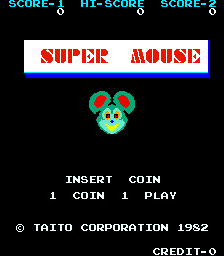
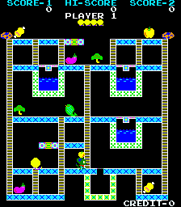

# Super Mouse for MiSTer

## Overview

FPGA implementation of **Super Mouse**, based on the original arcade game supported by MAME as `suprmous`.

Current status: functional behavioural implementation, mainly based on MAME/reference behaviour and available arcade hardware documentation.

The core supports the game's graphics, sound, controls and high-score persistence.

Only **Super Mouse** is supported. Funny Mouse is not included.

## Screenshots

| | |
| --- | --- |
|  |  |

## Installation

1. Copy `releases/Arcade-SuperMouse_20261006.rbf` to `/_Arcade/cores/` as `SuperMouse_20261006.rbf`. The official Distribution installer removes the `Arcade-` prefix.
2. Copy `releases/Super Mouse (suprmous).mra` to `/_Arcade/`.
3. Supply your legally obtained `suprmous.zip` in `/games/mame/` and launch the MRA.

**Important:** Move older Super Mouse RBFs outside `/_Arcade/cores/` before installing this release to avoid loading the wrong version.

No ROMs are included. The MRA uses the `suprmous` ROM set, compatible with the verified MAME 0.268 ROM configuration.

For additional information, see the [MiSTer Arcade ROM guide](https://github.com/MiSTer-devel/Main_MiSTer/wiki/Arcade-Roms).

## Controls and settings

Use the joystick or directional pad for movement.

The core supports Button 1, Coin, Start 1P and Start 2P.

**Button 1** drops a bomb during gameplay while bombs remain available.

OSD options include:

- Coinage
- Lives
- Bonus Life
- Cabinet
- Orientation
- Save High Score Now

Screen orientation is independent of the game's cabinet and flip settings.

## High-score persistence

The core supports high-score saving through MiSTer's NVRAM system.

The NVRAM file is stored at:

`/media/fat/config/nvram/Super Mouse (suprmous).nvm`

To save a qualifying high score:

1. Complete the game and allow the score to register.
2. Open the Super Mouse OSD.
3. Wait for the `Saving...` indication to finish.
4. Exit the core normally.

The **Save High Score Now** option allows a manual retry when valid high-score data is available.

High-score saving and restoration were exercised on earlier hardware candidates. The final release build successfully restored an existing saved score.

**Important:** Saving requires MiSTer menu servicing. Exiting directly or losing power before the save completes may result in lost scores.

Saving a newly earned score on the final release build and restoration after a power cycle have not yet been independently verified.

## Credits and licences

**GPL-3.0-or-later covers harlock74's original contributions only.**

Inherited material retains its own terms and notices.

| Component | Credits | Applicable terms / reference |
|---|---|---|
| Super Mouse game/video/audio implementation and high-score support | harlock74; inherited contributors where applicable | Scoped [owner grant](LICENSE); inherited terms retained |
| MiSTer integration and framework | MiSTer Template contributors | Retained GPL/LGPL and component-specific notices |
| T80 Z80 CPU | Daniel Wallner, Sorgelig and credited contributors | Original source/synthesized-form conditions retained |
| JT49 sound implementation | Jose Tejada Gomez and contributors | GPL-3.0-or-later; original notices retained |
| PLL and reconfiguration IP | Intel / Altera | Original vendor notices and device-use restrictions |
| Build and test infrastructure | MiSTer Template and project contributors | Original component notices retained |

For complete third-party attribution, licensing details and source provenance, see [NOTICE.md](NOTICE.md), [LICENSE](LICENSE), retained source headers and the accompanying `LICENSES/` directory.

Game ROMs and other copyrighted game assets are not distributed.

## Building the core

The project targets the Cyclone V **5CSEBA6U23I7** FPGA and uses **Quartus Prime Lite 17.0.2 Build 602**.

Open `SuperMouse.qpf` in Quartus and select **Full Compilation**.

Alternatively, from the project directory, run:

`quartus_sh --flow compile SuperMouse -c SuperMouse`

Required source files, IP, constraints and generator scripts are included in the repository.

The supplied release RBF is the previously tested build. A newly compiled RBF should be tested independently before distribution.

**Release SHA-256:**

`Arcade-SuperMouse_20261006.rbf`

`7f85c1073960acd5c3073045dbfc9b9f16d9c3602a5c4b6bcc7ae92dff3bfd59`